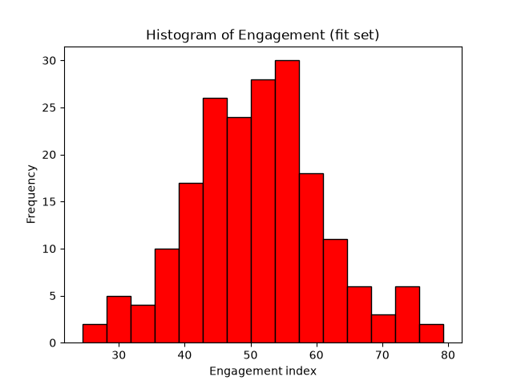
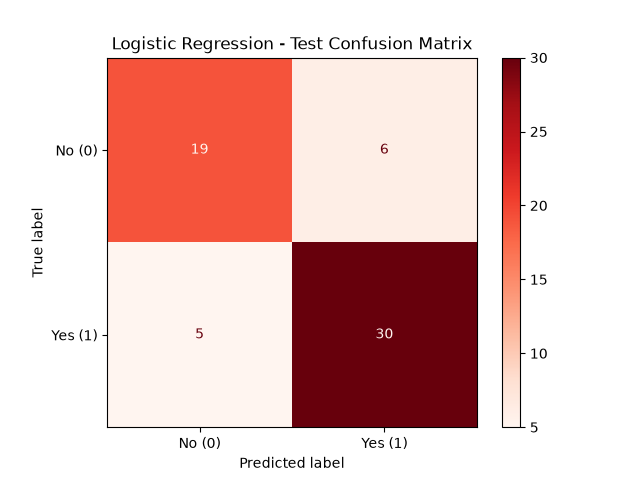
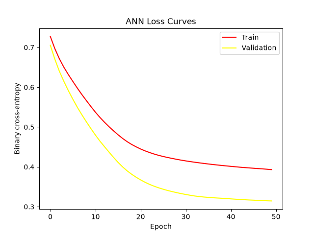
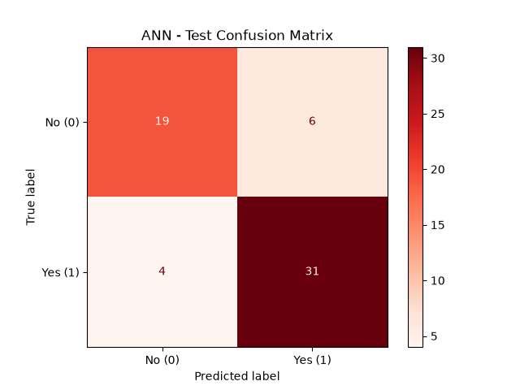

# Set A — Campaign Response Prediction & Audience Segmentation

**Mock Interview Practical · Round 3**

```
┌─────────────────────────────────────────────────────────────┐
│  CANDIDATE   Krish Desai  (@krish-desai-123)                 │
│  TRACK       Set A — Predict campaign responses &            │
│              identify audience segments                      │
│  ROUND       03                                               │
│  STATUS      ████████████████████████████  COMPLETE          │
└─────────────────────────────────────────────────────────────┘
```


---

### Jump to

`01` [What this round tests](#01--what-this-round-tests) &nbsp;·&nbsp;
`02` [The data](#02--the-data) &nbsp;·&nbsp;
`03` [Maths & Statistics](#03--maths--statistics) &nbsp;·&nbsp;
`04` [Preprocessing](#04--preprocessing--feature-engineering) &nbsp;·&nbsp;
`05` [Supervised Learning](#05--supervised-learning) &nbsp;·&nbsp;
`06` [Unsupervised Learning](#06--unsupervised-learning) &nbsp;·&nbsp;
`07` [Neural Network](#07--neural-network) &nbsp;·&nbsp;
`08` [Scoreboard](#08--scoreboard) &nbsp;·&nbsp;
`09` [Run it yourself](#09--run-it-yourself) &nbsp;·&nbsp;
`10` [Repo map](#10--repo-map) &nbsp;·&nbsp;
`11` [Walkthrough video](#11--walkthrough-video)

---

## `01` · What this round tests

A single synthetic marketing table — visits, recency, engagement, spend — is pushed through
**every stage of a data science pipeline in one sitting**: descriptive statistics and a
hypothesis test, leakage-safe preprocessing, a classic ML baseline vs. logistic regression,
unsupervised clustering to profile the audience, and finally a small neural network, all scored
on the same held-out test split.

```
raw CSV ──▶ stratified split ──▶ impute + encode + scale ──▶ baseline vs. logistic
                                         │
                                         ├──▶ KMeans segmentation (k = 2, 3, 4)
                                         │
                                         └──▶ ANN (16 → 8 → 1) ──▶ test-set verdict
```

> This is **Round 3** of the same practical format. The underlying dataset generator and tasks
> are unchanged from the earlier round — what's different here is the plotting palette (red
> histogram, red confusion-matrix heatmaps, red/yellow loss curves) and this write-up, which is
> deliberately laid out from scratch rather than reusing the previous round's template.

---

## `02` · The data

Synthetic, generated in-notebook with `numpy.random.default_rng(404)` so the run is fully
reproducible — no external download required.

| | |
|---|---|
| **Rows** | 305 (300 generated + 5 duplicated on purpose) |
| **Columns** | `visits`, `recency`, `engagement`, `spend`, `group`, `response` |
| **Target** | `response` — binary campaign-response flag |
| **Saved to** | `data/raw/set_a.csv` |
| **Injected noise** | 16 missing `visits`, 15 missing `recency`, 5 duplicate rows |

The label is driven by a hidden linear score over the four numeric features plus noise, so the
"true" signal is realistic but not trivially separable — which is exactly what the baseline vs.
logistic comparison in `05` is built to expose.

---

## `03` · Maths & Statistics

**Split** — `train_test_split(..., stratify=df.response, random_state=42)` →

| Split | Rows |
|---|---|
| Fit | 192 |
| Validation | 48 |
| Test | 60 |



*Engagement distribution across the fit set, plotted in red.*

**Welch's t-test** — engagement, Group 1 (n=84) vs. Group 2 (n=108):

```
t = 0.72      p = 0.47      →  no significant difference between groups
```

**95% confidence interval** for mean engagement (overall): `[49.54, 52.47]`

**Covariance & eigen-decomposition** of `(engagement, visits)` on 181 complete rows:

```
Cov =  ⎡ 103.66    4.12 ⎤        eigenvalues  = [99.23, 107.49]
       ⎣   4.12  103.06 ⎦        top/sum ratio = 0.52
                                  principal dir = [-0.73, -0.68]
```

The two eigenvalues are nearly equal and the principal direction sits almost on the diagonal —
engagement and visits carry comparably independent amounts of variance, with only a mild shared
trend between them.

---

## `04` · Preprocessing & Feature Engineering

| Check | Value |
|---|---|
| Raw shape | 305 × 7 |
| Missing — `visits` | 16 |
| Missing — `recency` | 15 |
| Duplicate rows | 5 |

Pipeline (fit **only** on the training split, then applied to validation/test to avoid leakage):

```
SimpleImputer(strategy="median")        →  fills visits / recency
OneHotEncoder(handle_unknown="ignore")  →  encodes `group` → group_G1, group_G2
engineered_feature = engagement / (recency + 1)
StandardScaler()                        →  scales all 5 numeric columns
```

Output shapes after transformation: **fit** 192×7 · **val** 48×7 · **test** 60×7, with final
feature order `visits, recency, engagement, spend, engineered_feature, group_G1, group_G2`.

Fitted objects persisted to `models/preprocessing.joblib` (`imputer`, `ohe`, `scaler` in one
bundle) for reuse at inference time.

---

## `05` · Supervised Learning

| Model | Accuracy | Precision | Recall | F1 |
|---|:---:|:---:|:---:|:---:|
| Dummy baseline (`most_frequent`) | 0.58 | 0.58 | 1.00 | 0.74 |
| **Logistic Regression** | **0.82** | **0.83** | **0.86** | **0.85** |



*Test-set confusion matrix, `cmap='Reds'`.*

The logistic model clears the "always predict the majority class" baseline by +0.24 accuracy and
+0.11 F1 — the engineered feature and scaling are earning their keep.

---

## `06` · Unsupervised Learning

`KMeans(n_init=10, random_state=42)` swept across k = 2, 3, 4 on the five scaled numeric
features (one-hot group columns excluded):

| k | Inertia | Silhouette |
|:---:|:---:|:---:|
| **2** | **713.03** | **0.23** |
| 3 | 613.55 | 0.19 |
| 4 | 541.65 | 0.19 |

**Selected k = 2** — highest silhouette score, ties broken toward the simpler model.

| Cluster | visits | recency | engagement | spend | engineered feature | size |
|---|:---:|:---:|:---:|:---:|:---:|:---:|
| 0 | 49.37 | 55.25 | 46.09 | 50.18 | 0.83 | 109 |
| 1 | 49.54 | 44.17 | 57.45 | 50.97 | 1.29 | 83 |

Cluster 1 is the more engaged, more recently active segment — higher engagement, lower recency,
and a meaningfully higher engineered engagement-per-recency ratio — a natural "warm audience" vs.
"cooler audience" split for targeting.

---

## `07` · Neural Network

```
Input(7) → Dense(16, relu) → Dense(8, relu) → Dense(1, sigmoid)
Optimizer: Adam(lr=0.001)       Loss: binary_crossentropy
EarlyStopping: monitor=val_loss, patience=5, restore_best_weights=True
Params: 273 total — all trainable
```

Trained for the full 50 epochs (`batch_size=16`) — early stopping never triggered, meaning
validation loss kept improving (or holding) throughout.



*Loss curves — training in red, validation in yellow.*



*ANN test-set confusion matrix, `cmap='Reds'`.*

| Model | Accuracy | Precision | Recall | F1 |
|---|:---:|:---:|:---:|:---:|
| **ANN** | **0.83** | **0.84** | **0.89** | **0.86** |

Saved as `models/ann.keras`.

---

## `08` · Scoreboard

Every model, same 60-row held-out test set:

| Rank | Model | Accuracy | Precision | Recall | F1 |
|:---:|---|:---:|:---:|:---:|:---:|
| 🥇 | ANN | 0.83 | 0.84 | 0.89 | **0.86** |
| 🥈 | Logistic Regression | 0.82 | 0.83 | 0.86 | 0.85 |
| 🥉 | Dummy Baseline | 0.58 | 0.58 | 1.00 | 0.74 |

**Takeaways**

- The ANN edges out logistic regression on every metric, but the margin is modest (+0.01
  accuracy, +0.01 F1) — on a dataset this size (192 training rows), that gap is well within
  noise, so logistic regression remains the more defensible production choice for its
  interpretability and lower variance.
- The dummy baseline's recall of 1.00 is a reminder, not an achievement — it predicts the
  majority class for everyone, so its "perfect recall" costs it all precision on the minority
  class.
- k = 2 segmentation is coarse by design; a richer feature set (channel, campaign history) would
  likely separate the audience further than k = 3/4 managed here.

**Limitations** — synthetic data generated from a single random seed, a 305-row dataset is small
for deep learning, and no hyperparameter search was run for either the logistic or the ANN model.

---

## `09` · Run it yourself

```bash
git clone https://github.com/krish-desai-123/Mock-Interview-Practical-.git
cd "Mock-Interview-Practical-/MIP-3"

python -m venv venv && source venv/bin/activate
pip install pandas numpy scikit-learn tensorflow matplotlib scipy joblib

jupyter notebook Pratical_Exam_Round_3.ipynb
```

```python
# Reload the fitted preprocessing + model for inference
import joblib
from tensorflow import keras

bundle = joblib.load("models/preprocessing.joblib")   # imputer, ohe, scaler
model  = keras.models.load_model("models/ann.keras")
```

---

## `10` · Repo map

```
MIP-3/
├── Pratical_Exam_Round_3.ipynb
├── README.md
├── data/
│   └── raw/
│       └── set_a.csv
├── models/
│   ├── preprocessing.joblib
│   └── ann.keras
└── outputs/
    └── figures/
        ├── engagement_hist.png
        ├── cm_logistic.png
        ├── ann_loss.png
        └── cm_ann.png
```

---

## `11` · Walkthrough video

> 🎬 **Video placeholder** — walkthrough link to be added here.
 [](https://www.loom.com/share/fc157ef0b2424d7c990eb08133dff7fa)
 
📺 **Video:** [Watch the full walkthrough on Loom](https://www.loom.com/share/fc157ef0b2424d7c990eb08133dff7fa)  ·  ⏱️ **Duration:** `X min`
 
A face + screen walkthrough of the problem, data cleaning and split, the statistics, the
leakage-safe preprocessing, both models, the clusters, and the ANN.


---

*All work is my own except where cited. Built for Round 3 of the Mock Interview Practical.*
